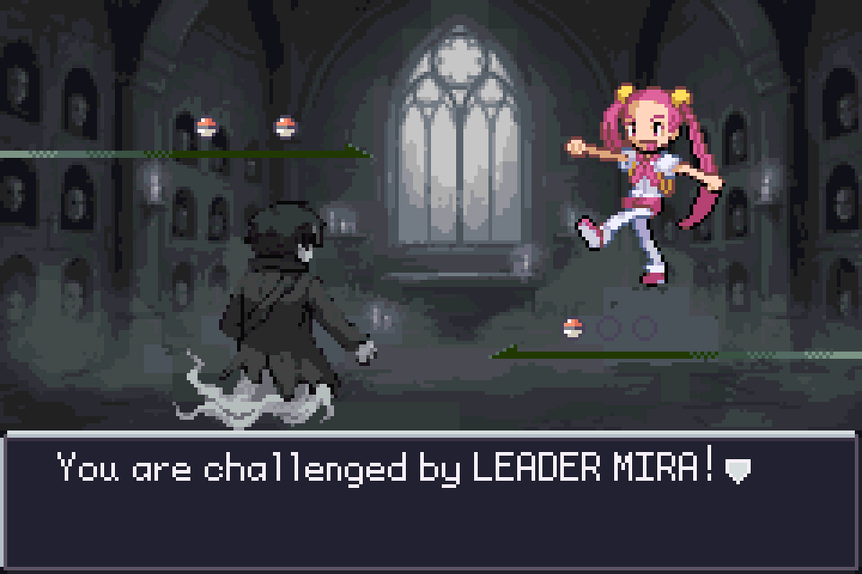
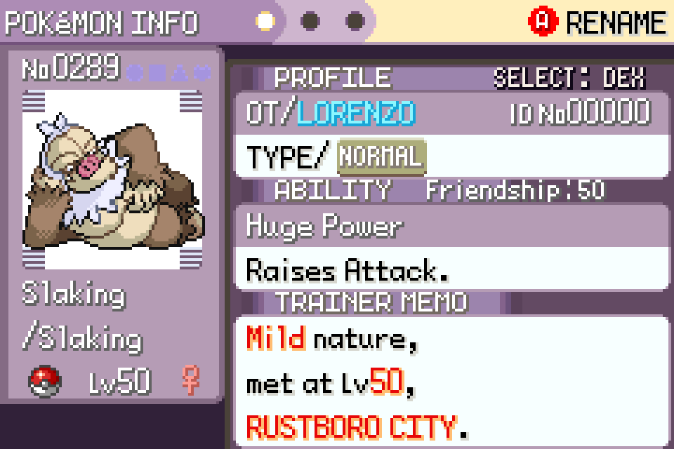

# Fantasma: Steal Any Ability. Wear Their Faces.

Play as a ghost that haunts a darker Hoenn. Steal abilities, identities and rob stores. Be the villain.

A Pokémon Emerald ROM hack built on [pokeemerald-expansion](https://github.com/rh-hideout/pokeemerald-expansion).

**[Download the latest patch (rc Fire)](https://github.com/BentleySB24/fantasma/releases/latest)** · [Report a bug](https://github.com/BentleySB24/fantasma/issues/new/choose) · [Hackdex page](https://www.hackdex.app/hack/fantasma)

This repository hosts release patches and bug reports. It contains no ROMs and no game data.

---

I've played Pokemon since the 90's and have always had an idea for a rom hack built around stealing abilities and applying them to ANY pokemon. Ghost typing always intrigued me growing up (big Gengar fan) and thus Fantasma (ghost in Italian) was born. I picked the Duskull line because it seemed the most likely to steal your abilities and it has the 3 stages that most starters have. Plus their art is dope.

## Features

- 50+ boss battles
- 100+ sigil items (stolen abilities). Works just like a nature mint. (It's very fun playing with a Huge Power Slaking or a Volt Absorb Gyarados... Trust me.) The enemies fight fire with fire and have custom abilities too!
- Original maps, handmade in Porymap: Lunar Woods, Bellgrave Abbey and the Cellar HQ
- Original quests: rob the mart, crack the Game Corner vault, hunt down Hoenn's gods after the League, plus a bunch of side stuff
- Minimal grind: Cap Candy, level catch up, EV Ashes, IV Salts (like bottle caps)
- Memory Altar: learn level up, TM, egg and move tutor moves all in one place
- 8+ disguises: play as the ghost and steal identities as you move through the gym ranks
- Wanted system, think GTA. The more evil stuff you do the more the heat rises and hunters come to ambush you!
- Golden Grave - in game slot machine that gives out items, mints and some special sigils you can't get anywhere else. The hotter your heat, the better the odds.
- Custom menu with modern graphics and a Tools section: Venom Cup (pre-poison your mons), Grave Dial (edit the time), Spirit Sight (permanent repel)
- Tons of QoL: Life Flask party heal, improved fly, sneak, portable PC, speed controls, Litwick Candle (auto-Flash), Type Chart item, move relearning anywhere, boss scouting before big fights. Plus a dozen smaller things you'll notice.

| | |
|---|---|
|  |  |
|  |  |
|  |  |

Part I is the full Hoenn story. Finish it and Unfair and Nuzlocke unlock for your next run. Part II (Kanto) is in active development.

## How to play

1. Download **Fantasma Part I rc Fire.zip** from the [latest release](https://github.com/BentleySB24/fantasma/releases/latest).
2. Patch a clean **Pokémon Emerald (USA/Europe)** ROM dumped from your own cartridge:
   - size 16,777,216 bytes, CRC32 `1F1C08FB`, SHA-1 `f3ae088181bf583e55daf962a92bb46f4f1d07b7`
   - use [Rom Patcher JS](https://www.marcrobledo.com/RomPatcher.js/), Floating IPS, or any BPS patcher.
3. A correctly patched game is 33,554,432 bytes, CRC32 `F84DC733`.
4. Play on **mGBA** (tested). If your emulator asks for a save type, choose **Flash 128K**.

Start a NEW GAME, save with the in-game SAVE option, and keep your save file for future versions. If you get stuck, START > GUIDE has a recap and an UNSTUCK option.

## Reporting bugs

[Open an issue](https://github.com/BentleySB24/fantasma/issues/new/choose) with the version (rc Fire), your emulator and device, where you were and what you were doing, and a screenshot if you can.

## Credits

Fantasma is a one-person project. The concept, the design, the story direction, the balance and every call on what goes in are mine. I built the new maps myself in Porymap, and I've playtested every build start to finish. I built it with AI tools: they wrote the scripts and most of the code, drafted dialogue that I directed and edited, and painted the battle backgrounds, menus and other new art.

Built on pokeemerald-expansion by Rom Hacking Hideout, with sprites by the Platinum OW/Trainer Sprite Pack team (spilledpizza and others), Kalarie, hyo, merrp and aarant, and tiles by LeoB and Roger Wrightshoe. Full credits: [CREDITS.md](CREDITS.md) and [ASSET_CREDITS.md](ASSET_CREDITS.md). Thank you to everyone listed there.

Fantasma is a free fan project. It is not affiliated with or endorsed by Nintendo, Game Freak, Creatures, or The Pokémon Company.
