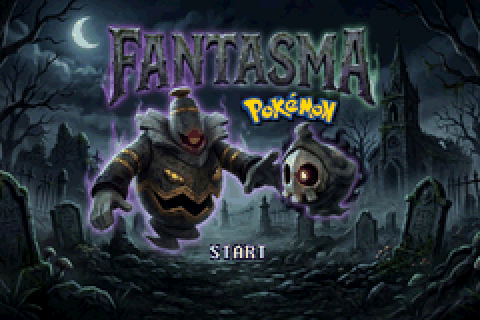
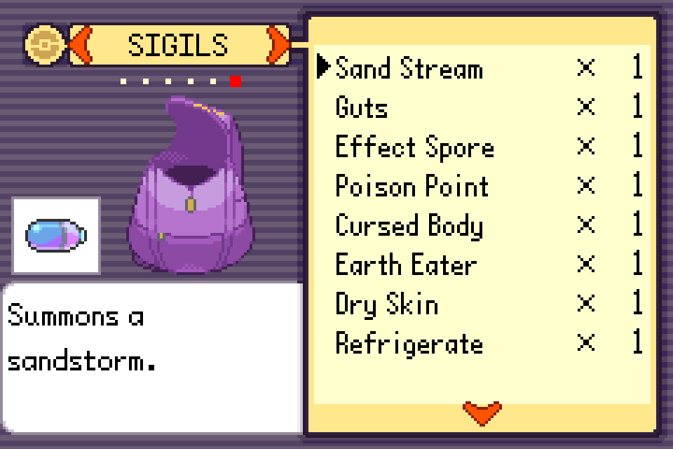
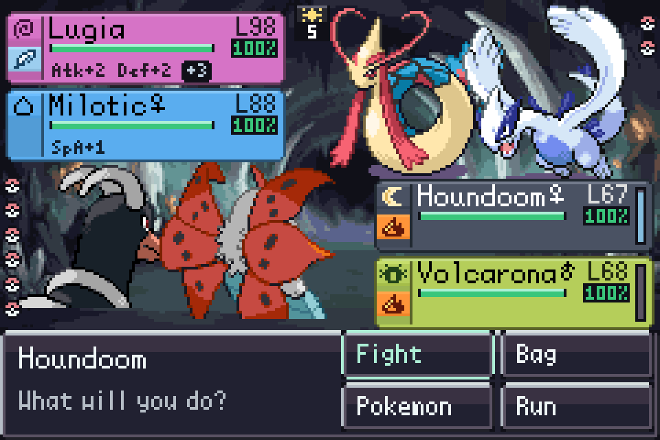
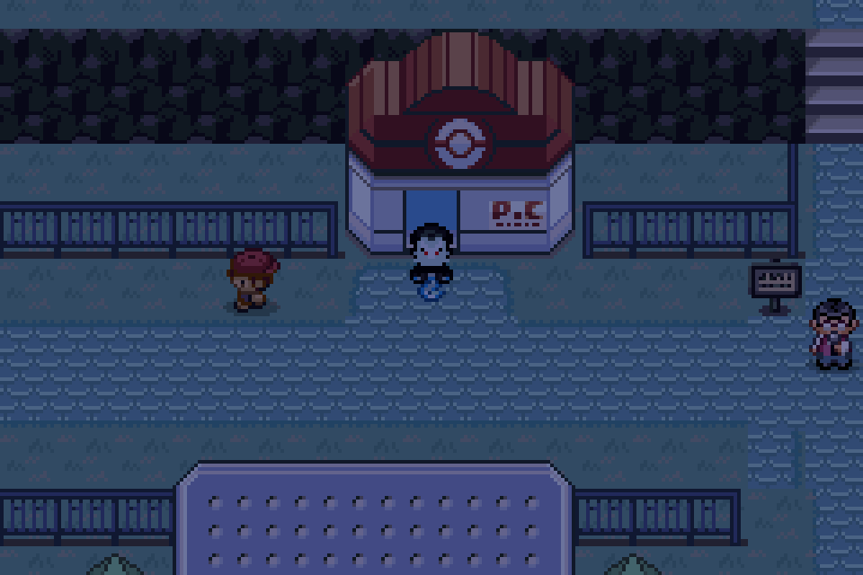
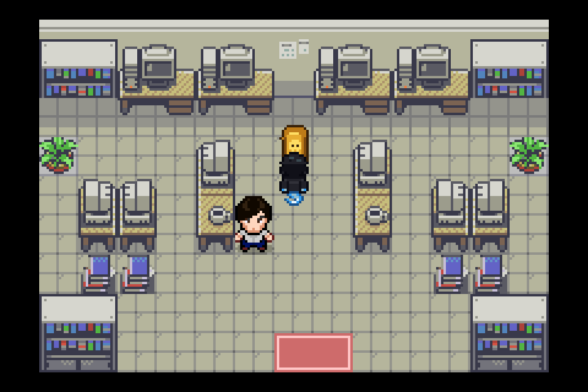
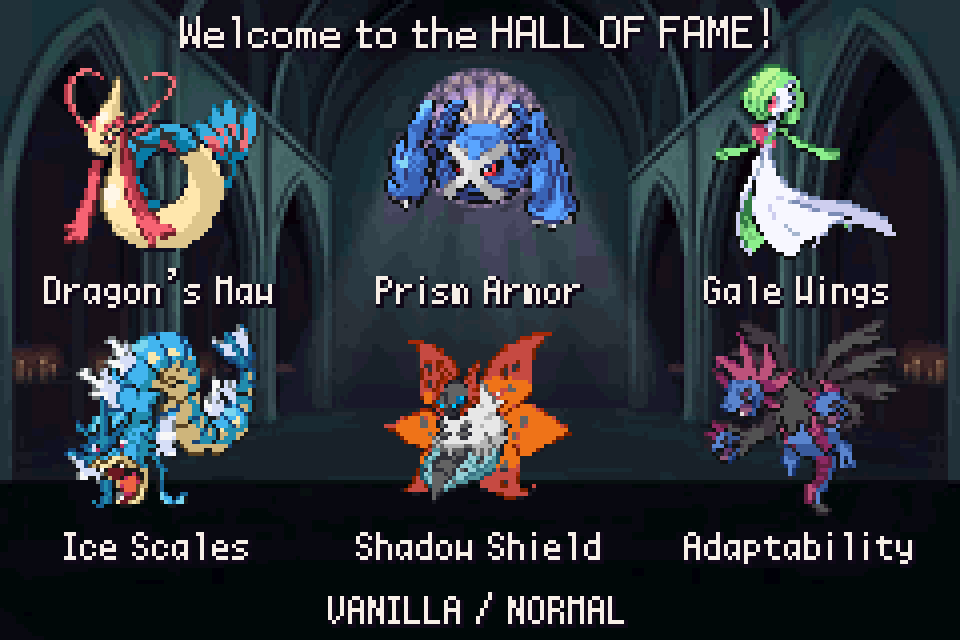
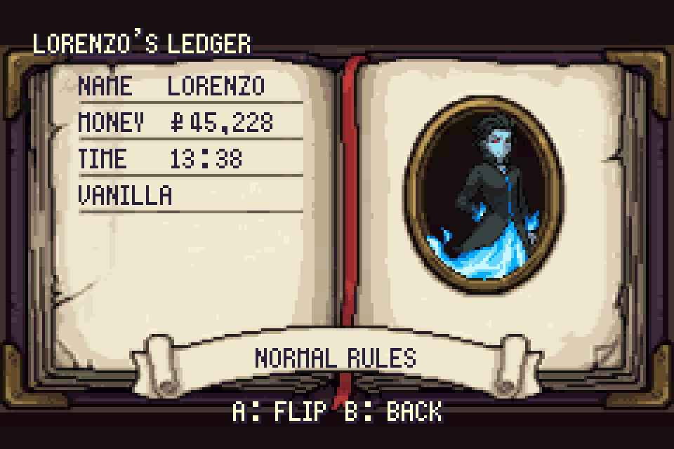

# Fantasma: Part I

**Play the villain. Steal their power. Wear their faces.**

A Pokémon Emerald ROM hack built on [pokeemerald-expansion](https://github.com/rh-hideout/pokeemerald-expansion).

**[Download the latest patch (rc Ghost)](https://github.com/BentleySB24/fantasma/releases/latest)** · [Report a bug](https://github.com/BentleySB24/fantasma/issues/new/choose) · [Hackdex page](https://www.hackdex.app/hack/fantasma)

This repository hosts release patches and bug reports. It contains no ROMs and no game data.

---

You are Lorenzo della Pira, Il Fantasma: a dead man who wakes in his family's graveyard with Duskull as his starter and companion. Your return begins a dark quest through Hoenn with 50+ boss fights, from its Gym Leaders to the League and, ultimately, its gods.

## Steal their power
Stealing abilities is the heart of Fantasma. Defeat powerful opponents and rip their abilities out as Spirit Sigils, then equip them on any Pokémon. Collect over 100 Sigils, discover powerful combinations, and turn your enemies' greatest strengths into your own.

## Wear their faces
Every leader you reave becomes a disguise you can wear. Rob shops, pull a vault heist, and fence stolen goods, but watch your Heat. Police cordons block gyms and shops, hunters stalk the routes, and a stolen face can get you past the law.

Return to your family's Cellar HQ for shops, training, and trophies. Enter the Sanctum, where the dead you robbed fight to reclaim their faces.

## A darker Hoenn
- Pokémon from Generations 1–9, placed by habitat.
- New Gym Leaders, Elite Four, and Champion.
- Custom maps, puzzles, and side quests, from the moonlit Lunar Woods to Bellgrave Abbey and sunken vaults.
- Reworked towns, painted battle backgrounds, and character portraits.
- Day/night cycle and optional following Pokémon.
- Boss scouting and expanded battle information.
- Level caps on Vanilla difficulty. Finish Part I to unlock **Unfair** and **Nuzlocke** for your next run.
- Extensive quality of life: quest log, portable PC, portable party healing, DexNav, speed controls, and convenient move relearning.

| | |
|---|---|
|  |  |
|  |  |

## Beyond the League
Becoming Champion opens the God Hunt: track down Hoenn's legendaries and take their power.

Part I contains the complete Hoenn story. Saves are intended to carry into Part II. Next stop: Kanto.

## How to play
1. Download **Fantasma Part I rc Ghost.zip** from the [latest release](https://github.com/BentleySB24/fantasma/releases/latest).
2. Patch a clean **Pokémon Emerald (USA/Europe)** ROM dumped from your own cartridge:
   - size 16,777,216 bytes, CRC32 `1F1C08FB`, SHA-1 `f3ae088181bf583e55daf962a92bb46f4f1d07b7`
   - use [Rom Patcher JS](https://www.marcrobledo.com/RomPatcher.js/), Floating IPS, or any BPS patcher.
3. A correctly patched game is 33,554,432 bytes, CRC32 `CCD8EF1F`.
4. Play on **mGBA** (tested). If your emulator asks for a save type, choose **Flash 128K**.

Start a NEW GAME, save with the in-game SAVE option, and keep your save file for future versions. Stuck? START > GUIDE has a recap of what to do next and an UNSTUCK option.

## Reporting bugs
[Open an issue](https://github.com/BentleySB24/fantasma/issues/new/choose) with the version (rc Ghost), your emulator and device, where you were and what you were doing, and a screenshot if you can.

## Credits and AI use
Fantasma is one person's project, built with AI as the dev team. Claude and Codex wrote and debugged most of the code on top of pokeemerald-expansion, ran headless-emulator testing, and ran Monte Carlo battle sims to help tune bosses, with final balance set by playtesting every fight. Gemini painted the title screen, battle backgrounds, and credits; Codex drafted the portraits, town art, and custom music; dialogue was written with AI help in a voice I set. Community art and tools are credited in [CREDITS.md](CREDITS.md) and [ASSET_CREDITS.md](ASSET_CREDITS.md). Thank you to everyone listed there.

Fantasma is a free fan project. It is not affiliated with or endorsed by Nintendo, Game Freak, Creatures, or The Pokémon Company.
